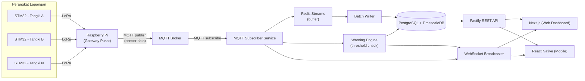
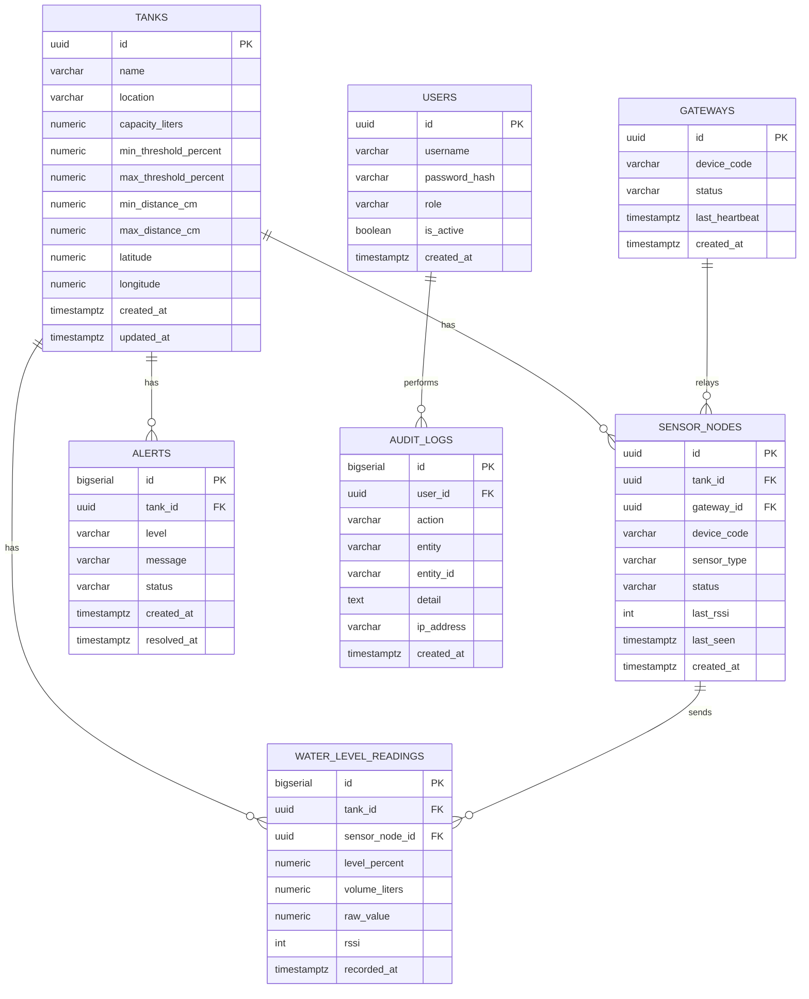
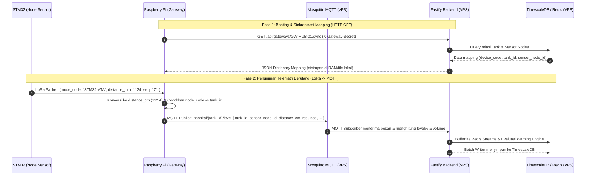

# Backend, Database & Monitoring/Warning Engine
### Integrated Hospital Water Tank Monitoring Research Project (RSA UGM)

> Dokumen ini adalah spesifikasi kebutuhan sistem backend. Arsitektur perangkat keras yang menjadi acuan: setiap tangki menggunakan **STM32**, data dikirim via **LoRa** ke satu unit **Raspberry Pi** yang berperan sebagai gateway/hub pusat, baru diteruskan ke backend via MQTT.
> 
> **Status Scope:** Sistem ini berfokus murni sebagai **Monitoring & Early Warning System** (membaca level air, menyimpan histori time-series, dan mengeluarkan peringatan WARNING/CRITICAL jika terjadi anomali level air). Jalur otomasi aktuator/kontrol pompa telah ditiadakan.

---

## 1. Ringkasan Proyek

Sistem ini memantau level air pada beberapa tangki di rumah sakit (atap gedung utama, rawat inap, instalasi bedah, laboratorium, laundry, dst) secara terpusat, mendeteksi kondisi kritis, dan memberi peringatan (warning/critical) ke operator melalui dashboard web dan mobile.

Backend bertanggung jawab pada **inti pemrosesan data**: menerima data dari gateway (via MQTT), melakukan buffering pesan (mencegah lonjakan data), menyimpannya secara terstruktur di database PostgreSQL/TimescaleDB, mencatat histori & audit, mendeteksi kondisi peringatan melalui Warning Engine, serta menyediakan REST API dan WebSocket untuk dikonsumsi oleh dashboard frontend (web Next.js & mobile React Native).

**Alur perangkat fisik:**

```
[STM32 @ Tangki A] ─┐
[STM32 @ Tangki B] ─┤  LoRa   ┌────────────────┐   MQTT   ┌────────────┐
[STM32 @ Tangki C] ─┼────────▶│ Raspberry Pi   │─────────▶│            │
[STM32 @ Tangki D] ─┤         │ (1 unit, hub)  │          │  Backend   │
[STM32 @ Tangki N] ─┘         └────────────────┘          └────────────┘
                                                                 │
                                                        PostgreSQL/Timescale
                                                                 │
                                                        API + WebSocket
                                                                 │
                                                     Next.js (web) / React Native (mobile)
```

---

## 2. Kebutuhan Sistem (Requirements)

### Functional
- Menerima data telemetri jarak fisik sensor ultrasonik (`distance_cm`) dari gateway via MQTT.
- Menghitung persentase ketinggian air (`level_percent`) dan estimasi volume air (`volume_liters`) secara terpusat di backend menggunakan konfigurasi kalibrasi tangki (`min_distance_cm`, `max_distance_cm`, `capacity_liters`).
- Menyimpan data mentah jarak dan data hasil olahan (level %, volume liter) beserta timestamp ke database.
- Melakukan deduplikasi paket LoRa mesh berdasarkan `sequence` transmisi untuk mencegah pencatatan berulang.
- Mengabaikan aktivasi alarm darurat pada data tertunda (*stale buffered data*, `is_buffered: true` dengan umur > 5 menit) untuk mencegah banjir notifikasi usang.
- **Warning Engine**: Mendeteksi kondisi WARNING (30-60%) dan CRITICAL (<30%), lalu secara otomatis membuat atau menutup (resolve) entri alert.
- Mencatat **audit log** untuk aksi pengguna di sistem (login, perubahan konfigurasi threshold tangki, dsb).
- Menyediakan **REST API** untuk query data tangki, riwayat histori pembacaan (grafik 24 jam dengan agregasi), daftar alert aktif/histori, dan data gateway.
- Menyediakan **realtime channel** (WebSocket terotentikasi JWT) untuk mendorong pembaruan level air dan notifikasi alert baru secara instan ke dashboard.
- Mendeteksi status koneksi node/gateway (online/offline) berdasarkan interval heartbeat dan pesan last seen.

### Non-Functional
- **Latency rendah**: Dari data masuk MQTT sampai terkirim ke API/WebSocket (target sub-detik s/d beberapa detik).
- **High throughput & buffering**: Tahan terhadap lonjakan pesan ketika banyak tangki mengirim data bersamaan dengan menggunakan Redis Streams sebagai buffer sebelum batch insert ke DB.
- **Penyimpanan time-series efisien**: Menggunakan PostgreSQL dengan ekstensi TimescaleDB (hypertable) agar query rentang waktu dan agregasi grafik 24 jam tetap cepat.
- **Reliable & resilient**: Penanganan diskoneksi MQTT dengan auto-reconnect.
- **Auditable**: Seluruh aktivitas administratif dan perubahan konfigurasi tercatat rapi dalam audit log.

---

## 3. Tech Stack

| Layer | Pilihan | Alasan Singkat |
|---|---|---|
| Runtime | **Node.js (LTS, v22+) & TypeScript** | Ekosistem MQTT & PostgreSQL matang, type-safety tinggi |
| Web Framework (API) | **Fastify** | Cepat, schema validation terintegrasi, plugin WebSocket resmi |
| MQTT Client | `mqtt` (npm) | Standar industri, stabil, mendukung QoS & auto-reconnect |
| Realtime ke FE | **WebSocket** (`@fastify/websocket`) | Push update level & alert langsung ke Next.js & React Native |
| Database | **PostgreSQL** | Database relasional handal untuk master data |
| Ekstensi Time-Series | **TimescaleDB** (extension PostgreSQL) | Efisien untuk pembacaan sensor volume tinggi + agregasi grafik 24 jam |
| Buffer / Ingestion Queue | **Redis Streams** | Menampung burst pesan MQTT sebelum batch-insert ke database |
| ORM / Query Builder | **Drizzle ORM** | Type-safe, performa tinggi, ringan, migrasi skema mudah |
| Validasi | **Zod** | Validasi payload MQTT dan input request API |
| Autentikasi API | **JWT** (`@fastify/jwt`) | Autentikasi token untuk endpoint REST API |
| Manajemen Proses | **Worker terpisah** | Pemisahan proses HTTP API dan MQTT Ingestion Worker |

---

## 4. Arsitektur



**Catatan Arsitektur:**
- **Sistem Satu Arah (One-Way Data Flow):** Data mengalir dari sensor perangkat lapangan ke gateway, dipublish ke MQTT broker, diolah oleh backend, dan disajikan ke frontend.
- **Pemisahan Worker & API:** Ingest data sensor (MQTT + Redis Streams) dijalankan secara independen sehingga lonjakan pengiriman pesan dari banyak tangki tidak memperlambat respon Fastify REST API.
- **Warning Engine Realtime:** Pengecekan threshold langsung dievaluasi saat pesan sensor masuk untuk memastikan alert peringatan segera disiarkan via WebSocket tanpa menunggu proses batch-insert database selesai.

---

## 5. Komunikasi Data (MQTT)

Komunikasi dengan Gateway & Broker menggunakan protokol **MQTT**:

| Topic | Arah | QoS | Keterangan |
|---|---|---|---|
| `hospital/{tank_id}/level` | Gateway → Backend | 0 | Data level air periodik, frekuensi tinggi |
| `hospital/{tank_id}/status` | Gateway → Backend | 1 | Status konektivitas dan kesehatan node sensor |
| `hospital/{tank_id}/heartbeat` | Gateway → Backend | 0 | Keep-alive berkala per node / gateway |

### Contoh Payload (`level`)
Gateway Raspberry Pi memublikasikan data fisik pengukuran jarak sensor secara efisien tanpa redundansi:
```json
{
  "tank_id": "f5d31c46-1ae8-4838-ba0e-4eb5c8705831",
  "sensor_node_id": "a513b2b5-0c97-4dab-baf6-2b6d57aa4944",
  "distance_cm": 112.4,
  "rssi": -68,
  "sequence": 171,
  "is_buffered": false,
  "timestamp": "2026-11-16T08:50:00.120Z"
}
```
*Catatan:* Field `level_percent` dan `volume_liters` ditiadakan dari payload Raspberry Pi untuk menghindari redundansi data dan duplikasi kalkulasi di sisi perangkat keras tepi (*edge*). Backend secara otomatis menghitung nilai tersebut berdasarkan parameter kalibrasi tangki.

### Contoh Payload (`status`)
```json
{
  "tank_id": "f5d31c46-1ae8-4838-ba0e-4eb5c8705831",
  "sensor_node_id": "a513b2b5-0c97-4dab-baf6-2b6d57aa4944",
  "status": "online",
  "battery_level": 94,
  "timestamp": "2026-11-16T08:50:00.120Z"
}
```

---

## 6. Alur Data (End-to-End)

1. Sensor ultrasonik DYP-A01 pada modul STM32 membaca jarak pantulan ke permukaan air (dalam satuan milimeter).
2. Data dikirimkan via modul radio **LoRa E220** (dengan mekanisme anti-tabrakan dan relay mesh) ke unit Raspberry Pi.
3. Raspberry Pi mengonversi jarak ke satuan centimeter (`distance_cm`) lalu mem-publish pesan ke **MQTT broker** pada topik `hospital/{tank_id}/level`.
4. **MQTT Subscriber Service** menerima pesan dan:
   - Memvalidasi integritas data dengan **Zod** (`mqttLevelPayloadSchema`).
   - Melakukan filter duplikasi paket LoRa mesh berdasarkan `sequence` transmisi.
   - Mengambil konfigurasi kalibrasi tangki (`min_distance_cm`, `max_distance_cm`, `capacity_liters`) melalui cache `TankCalculatorService`.
   - Mengalkulasi persentase level air (`level_percent`) dan volume liter (`volume_liters`) secara presisi.
   - Memasukkan data ke buffer **Redis Streams**.
   - Meneruskan data ke **Warning Engine** untuk evaluasi threshold (dengan pengecekan umur data buffer).
   - Menyiarkan event `LEVEL_UPDATE` secara langsung via **WebSocket Broadcaster**.
5. **Batch Writer** membaca data dari Redis Streams secara periodik (setiap 3 detik), lalu menyimpan ke tabel time-series **PostgreSQL/TimescaleDB** (`water_level_readings`).
6. Jika level air masuk ke rentang WARNING (30-60%) atau CRITICAL (<30%), Warning Engine otomatis mencatat record di tabel `alerts` dan menyiarkan event `ALERT_TRIGGERED`.
7. Jika level air kembali normal (>60%), alert yang aktif otomatis ditandai sebagai `resolved` dan disiarkan via event `ALERT_RESOLVED`.
8. Dashboard web dan mobile menangkap data realtime melalui WebSocket tanpa perlu me-reload halaman.
9. Dashboard memanggil **REST API** Fastify untuk menampilkan grafik historis 24 jam, master data tangki, status node sensor, dan laporan CSV.

---

## 7. Skema Database (PostgreSQL & TimescaleDB)

### Entitas Utama (7 Core Tables)
- **tanks**: Master data tangki (nama, kapasitas, lokasi, batas threshold peringatan).
- **gateways**: Data unit Raspberry Pi perantara LoRa ke MQTT.
- **sensor_nodes**: Data modul node STM32 per tangki.
- **water_level_readings**: Data time-series hasil pembacaan sensor (hypertable TimescaleDB).
- **alerts**: Riwayat peringatan WARNING/CRITICAL beserta status penanganannya.
- **users**: Akun operator dan administrator sistem.
- **audit_logs**: Riwayat jejak audit aktivitas pengguna dan sistem.

### ERD (Mermaid)



### Catatan Implementasi Database
- `water_level_readings` diatur sebagai **hypertable TimescaleDB** dengan partisi berbasis kolom `recorded_at`, dilengkapi continuous aggregate untuk query grafik 24 jam yang cepat.
- Indeks komposit dibuat pada `(tank_id, recorded_at DESC)` di tabel `water_level_readings`.
- Kolom `alerts.status` menggunakan enum/tipe data: `'active'` dan `'resolved'`.
- Status `sensor_nodes.status` dan `gateways.status` diperbarui berdasarkan pesan heartbeat/last seen untuk mendeteksi perangkat offline secara otomatis.

---

## 8. Catatan Pengembangan & Integrasi
- Kebijakan retensi data dan downsampling di TimescaleDB (data mentah disimpan 30 hari, data agregasi per jam disimpan 1 tahun).
- Koordinasi spesifikasi skema response REST API dan event payload WebSocket dengan tim Frontend (Web & Mobile).
- Mekanisme autentikasi JWT token antara Fastify backend dan client dashboard.
- Strategi buffering lokal di Raspberry Pi jika koneksi internet/MQTT sempat terputus.

---

## 9. Sistem Autentikasi & Hak Akses (Role-Based Access Control)

Backend menerapkan autentikasi berbasis JSON Web Token (JWT) dengan Role-Based Access Control (RBAC) pada tabel `users`. Setiap permintaan ke REST API (kecuali endpoint publik seperti `/health` dan `/api/auth/login`) wajib menyertakan header `Authorization: Bearer <token>`.

### Daftar Role Pengguna

| Role | Deskripsi | Hak Akses |
|---|---|---|
| **admin** | Administrator teknis / sistem | Akses penuh: CRUD master data tangki, konfigurasi threshold, manajemen pengguna, manajemen gateway, dan audit log. |
| **operator** | Petugas / teknisi lapangan rumah sakit | Read master data & monitoring, melakukan resolve/penanganan alert peringatan, memperbarui status operasional tangki. |
| **viewer** | Pihak manajemen / dashboard display | Read-only: Melihat status level air, grafik histori 24 jam, dan riwayat alert aktif tanpa hak manipulasi data. |

### Matriks Akses Endpoint REST API

| Endpoint | Method | Role yang Diizinkan | Keterangan |
|---|---|---|---|
| `/health` | GET | Publik (Tanpa Auth) | Probe health check server & database |
| `/api/auth/login` | POST | Publik (Tanpa Auth) | Otentikasi username & password, mengembalikan token JWT |
| `/api/auth/me` | GET | `admin`, `operator`, `viewer` | Profil pengguna saat ini dari token |
| `/api/users` | GET | `admin` | Daftar seluruh akun pengguna sistem |
| `/api/users` | POST | `admin` | Menambahkan akun pengguna baru |
| `/api/users/:id` | PATCH, PUT | `admin` | Memperbarui role atau status keaktifan pengguna |
| `/api/users/:id` | DELETE | `admin` | Menghapus atau menonaktifkan pengguna |
| `/api/tanks` | GET | `admin`, `operator`, `viewer` | Daftar seluruh tangki beserta status terbaru & sensor node |
| `/api/tanks/:id` | GET | `admin`, `operator`, `viewer` | Detail data tangki beserta 50 pembacaan & alert terakhir |
| `/api/tanks/:id/readings` | GET | `admin`, `operator`, `viewer` | Histori time-series level air tangki tertentu (query: `hours`, `limit`) |
| `/api/tanks` | POST | `admin` | Menambahkan master tangki baru beserta konfigurasi threshold |
| `/api/tanks/:id` | PATCH, PUT | `admin` | Memperbarui data tangki atau batas threshold peringatan |
| `/api/tanks/:id` | DELETE | `admin` | Menghapus master tangki |
| `/api/readings/latest` | GET | `admin`, `operator`, `viewer` | Pembacaan level air terkini seluruh tangki |
| `/api/readings/history` | GET | `admin`, `operator`, `viewer` | Agregasi data time-series histori seluruh tangki |
| `/api/alerts` | GET | `admin`, `operator`, `viewer` | Daftar riwayat alert (opsional filter `?status=active` atau `resolved`) |
| `/api/alerts/:id/resolve`| PATCH, PUT | `admin`, `operator` | Menandai alert bahaya sebagai selesai / ditangani |
| `/api/gateways` | GET | `admin`, `operator` | Informasi kesehatan perangkat gateway Raspberry Pi |
| `/api/gateways/:deviceCode/sync`| GET | Internal / Gateway Key / `admin` | Endpoint sinkronisasi mapping tangki & sensor untuk Raspberry Pi |
| `/api/nodes` | GET | `admin`, `operator`, `viewer` | Daftar seluruh modul sensor node STM32 beserta relasinya |
| `/api/audit-logs` | GET | `admin` | Audit trail aktivitas pengguna di sistem (paginated) |
| `/api/reports/readings/export` | GET | `admin`, `operator`, `viewer` | Download data pembacaan sensor dalam format CSV |
| `/api/reports/alerts/export` | GET | `admin`, `operator`, `viewer` | Download rekapitulasi riwayat peringatan dalam format CSV |

---

## 10. Protokol Komunikasi Gateway Raspberry Pi ke Backend di VPS

Raspberry Pi bertindak sebagai gateway sentral yang menerima sinyal telemetri LoRa dari modul STM32 di tiap tangki, lalu meneruskannya ke broker MQTT di VPS.



### Cara Raspberry Pi Mendapatkan `tank_id` dan `sensor_node_id`

Terdapat 2 mekanisme integrasi yang didukung secara *hybrid*:

#### 1. Mekanisme Utama: Auto-Sync Konfigurasi saat Booting
1. Saat program gateway Python/C di Raspberry Pi dinyalakan, gateway memanggil endpoint:
   ```http
   GET /api/gateways/GW-HUB-01/sync
   Header: X-Gateway-Key: <GATEWAY_SECRET_KEY>
   ```
2. Backend merespon dengan peta relasi lengkap tangki dan sensor:
   ```json
   {
     "success": true,
     "gatewayCode": "GW-HUB-01",
     "syncedAt": "2026-11-16T15:30:00Z",
     "mappings": [
       {
         "deviceCode": "STM32-ATA",
         "sensorNodeId": "6b464034-79f0-46fe-a7e4-7bd3b7fa9c8a",
         "tankId": "a6f5ade5-777c-4871-a584-de40d11df30d",
         "tankName": "Tangki Atap Gedung Utama",
         "capacityLiters": "10000.00",
         "minDistanceCm": "30.00",
         "maxDistanceCm": "350.00"
       },
       {
         "deviceCode": "STM32-GED",
         "sensorNodeId": "ec120989-a026-4935-bded-fae8885b2106",
         "tankId": "fffce8f9-04e2-4f9e-9302-fd2e1c6d1825",
         "tankName": "Tangki Gedung Rawat Inap",
         "capacityLiters": "8000.00",
         "minDistanceCm": "25.00",
         "maxDistanceCm": "320.00"
       }
     ]
   }
   ```
3. Raspberry Pi menyimpan dictionary ini di memori lokal. Ketika paket LoRa masuk dari `STM32-ATA`, Raspberry Pi langsung memasukkan `tank_id` dan `sensor_node_id` yang sesuai ke dalam payload MQTT.

#### 2. Mekanisme Cadangan: Auto-Resolution di Sisi Backend
Jika Raspberry Pi belum sempat melakukan sync atau firmware lama hanya mengirimkan kode string fisik (`sensor_node_id: "STM32-ATA"`), backend secara otomatis melakukan pencarian ke tabel `sensor_nodes` untuk menemukan relasi `tank_id`-nya secara transparan tanpa menyebabkan error validasi database.

### Keamanan Jalur Komunikasi Raspberry Pi ke VPS
* **Opsi Jaringan Terisolasi (Tailscale Mesh):** Raspberry Pi terhubung ke jaringan Tailscale yang sama dengan VPS. Komunikasi MQTT mengarah ke IP `100.94.192.102:1883` yang terenkripsi penuh melalui WireGuard tanpa mengekspos broker ke internet publik.
* **Opsi Autentikasi Broker:** Mosquitto dapat diatur dengan autentikasi `username` dan `password` khusus perangkat IoT gateway.
